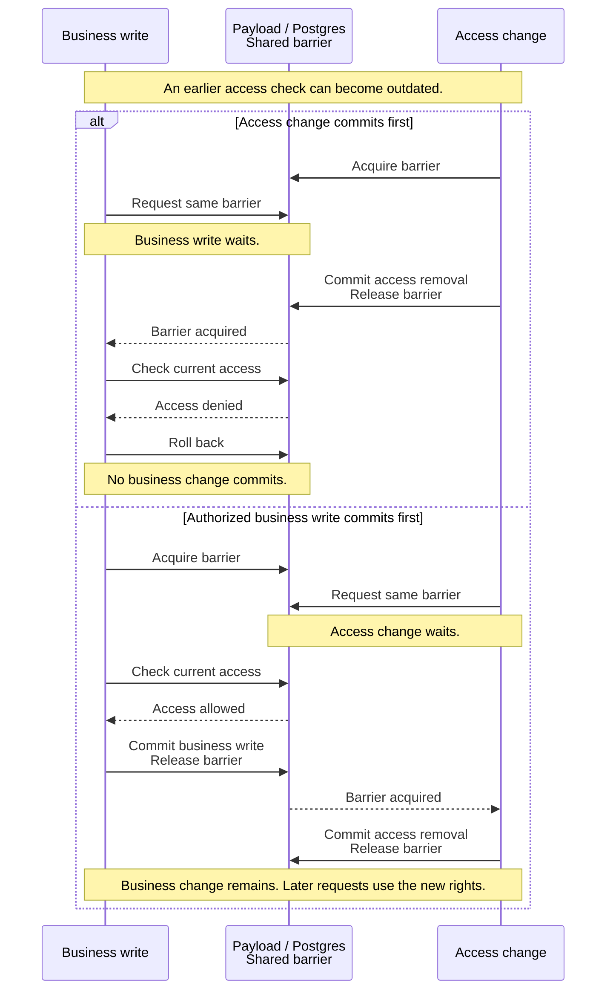

# ADR: Order of clinic access changes and business writes

## Status

| Name | Content |
| --- | --- |
| Author | AI-assisted draft for Sebastian Schütze |
| Version | 1.0 |
| Date | 17.10.2026 |
| Status | Approved |
| Approved by | Sebastian Schütze |
| Approval evidence | Explicit user approval in the ADR review chat on 17.10.2026 |

## Background

Central staff need access to several clinics in a group. Local staff need access only to their assigned clinic.
These rights can change when a clinic changes group or a staff member receives a different assignment.
Requests may already be in progress when these changes occur. An earlier login or browser view must not preserve access after its removal.

Website/Payload checks access rights and stores clinic data. A business write changes clinic data, such as a profile or an inquiry.
A commit makes a transaction's changes permanent. A rollback cancels those changes.
An authorized business write must remain valid if it commits before an access change.

## Problem Description

A request can pass an access check, lose access, and still commit its business write.
A transaction alone does not prevent this conflict. Access changes and business writes need one rule that determines which change can commit first.

## Considerations

- An access check alone leaves time for access to change before commit, even if the check occurs near commit.
- Serializable isolation alone does not guarantee which transaction commits first.
- The existing authorization barrier coordinates transactions through shared control records in Payload.
  [ADR-035](035-adr-notification-acknowledgement-decision-time.md) uses this barrier for notification acknowledgements. Extending it avoids separate lock storage and direct SQL.

## Decision with Rationale

Use the existing authorization barrier for access changes and business writes.
Transactions write to shared control records for each clinic and staff member.
Conflicting transactions must wait or abort. The barrier protects each transaction until commit or rollback.
This gives the two outcomes:

- If an access change commits first, a business write that loses access cannot commit.
- If an authorized business write commits first, the access change follows it. The business write remains part of the clinic history.

The diagram shows transactions that wait. A conflict can also stop a transaction. Its existing retry rules still apply.

All operations that change access must use the barrier.
This includes clinic group changes, assignment replacement or removal, and changes to staff or clinic eligibility.
The barrier also covers writes for profiles, treatments, galleries, media, doctors, inquiries, reviews, and notifications.
These rules apply to direct collection writes, Website API requests, hooks, and trusted background tasks.
Group deletion and changes to group references must coordinate so that assignments cannot refer to a deleted group.
The barrier must work when notification capture is inactive or notification controls do not yet exist.

One outer Payload transaction owns the barrier, access checks, and business writes. Operations inside that transaction use the same transaction.
Before commit, the owner checks the current stored records for:

- The staff identity, account status, and completed activation.
- The current clinic or group assignment.
- The clinic's eligibility and permission for the requested action.
- The clinic that owns the source record.

The barrier remains active during this final check and through commit.
A write cannot continue if its transaction owner is unknown or its transaction no longer exists.

The existing Payload mechanism can provide this ordering. It needs no additional exception under [ADR-033](033-adr-auth-actions-owned-transactions.md).
This decision permits no new direct SQL, adapter transaction controls, or global isolation changes.
ADR-033's existing exceptions and ADR-035's notification expiry rule remain unchanged.

Only committed transactions determine the order. The owner returns success only after the database reports a successful commit.
An operation may retry only if its existing rules permit automatic retries.
For such operations, database-reported aborts caused by concurrent transactions permit at most three total attempts.
Each attempt checks access again for the original operation and clinic.
Notification acknowledgements retain their existing retry restrictions and original selection of notifications.

An uncertain commit or rollback result prevents an automatic retry.
A completed rollback cleanup call does not prove that the transaction aborted.
Actions outside the database must not run inside transactions that can retry.

## Technical Debt

Operations for the same clinic or staff member must wait for each other. This reduces how much work can run in parallel.
The barrier also uses storage with notification-specific names, although it now protects other writes.
Website must keep one owner for the barrier. New operations that write data must use the barrier where these rules apply.

## Risks

An operation that bypasses the barrier can commit after access is lost.
Incorrect rollback handling can leave partial changes or cause an unsafe retry.
Real Payload/Postgres tests must prove both commit orders, including direct collection writes and notification actions.
Tests must check stored business data and current access after commit, rollback, and conflicts between transactions.
This ADR defines the architecture decision. Implementation, test procedures, environment activation, and deployment follow separately after approval.
