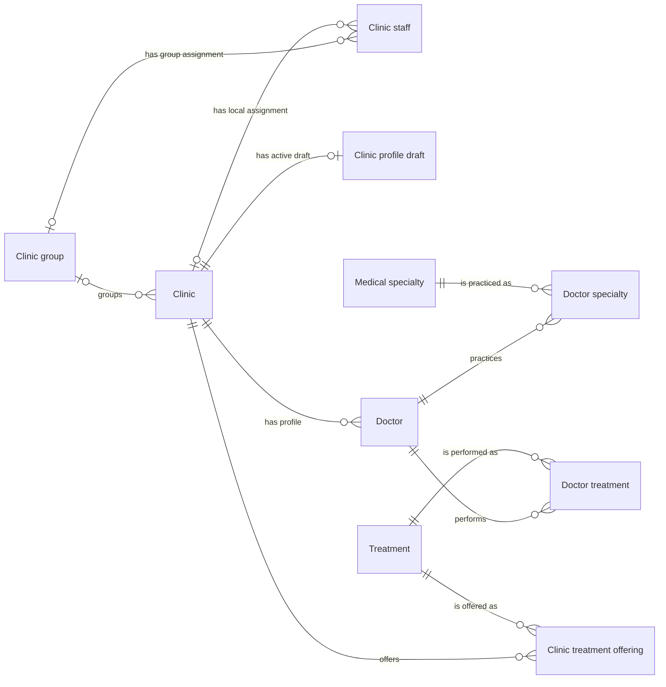

# Website domain model

Payload owns the Website's business records. The [glossary](../../GLOSSARY.md) defines the domain terms. Use the
[registered collections and globals](../../src/payload.config.ts) and their [collection definitions](../../src/collections)
for fields, validation, relationships, and indexes. Use the [generated types](../../src/payload-types.ts) for TypeScript
document shapes and the [migrations](../../src/migrations) for the database schema.

## Clinics, people, and treatments

- Clinic application approval links the clinic and the initial staff member and authorizes private Dashboard
  participation. Public publication and the staff member's account activation are separate decisions. The clinic
  record holds the published profile. An active profile draft holds proposed changes to its core fields.
  [Clinic participation](../security/clinic-participation.md) ·
  [Clinic profile provider contract](../integrations/clinic-dashboard-api.md)
- A doctor profile describes a clinician. Dashboard access comes from a clinic staff assignment and current
  authorization. A clinic can belong to one group or stay independent. A staff member has one local assignment
  to a clinic, one group assignment, or neither. Group assignments grant access through current membership.
  [Clinic groups](../security/clinic-groups.md) ·
  [Staff assignments](../security/clinic-staff-assignments.md)
- A treatment is a shared definition. Each clinic treatment offering carries that clinic's price and availability.
  Doctor treatment and specialty records describe a doctor's practice independently of a clinic's offers.
  [Treatment definitions](../../GLOSSARY.md#treatments)

## Patient interactions and reviews

- A saved clinic links a patient and a clinic. An inquiry belongs to its receiving clinic. Historical guest
  inquiries can exist without an authenticated patient or a conversation. An anonymous clinic contact request
  now creates a private preparation, with inquiry creation after the verified patient handoff. Private conversation
  messages and clinic-only notes have different access rules. [Saved clinics](../../src/collections/FavoriteClinics.ts) ·
  [Prepared inquiry handoff](../security/auth-actions.md#prepared-inquiry-handoff) ·
  [Inquiry terms](../../GLOSSARY.md#inquiries) · [Clinic Dashboard provider contract](../integrations/clinic-dashboard-api.md)
- A review identifies a clinic, a doctor, and a treatment. It can have one clinic response workflow
  and one appeal. Review approval, public moderation, author withdrawal, and the appeal outcome are independent.
  [Review lifecycle, version history, and audit](../review-modification-process.md)

## Editorial content and media

Pages and posts carry editorial content. Globals own shared navigation, consent settings, and curated landing-page
content. Media records separate platform content, clinic assets, doctor assets, and account images by ownership.
[Global definitions](../../src/globals) · [Media ownership and storage](../integrations/storage.md)
